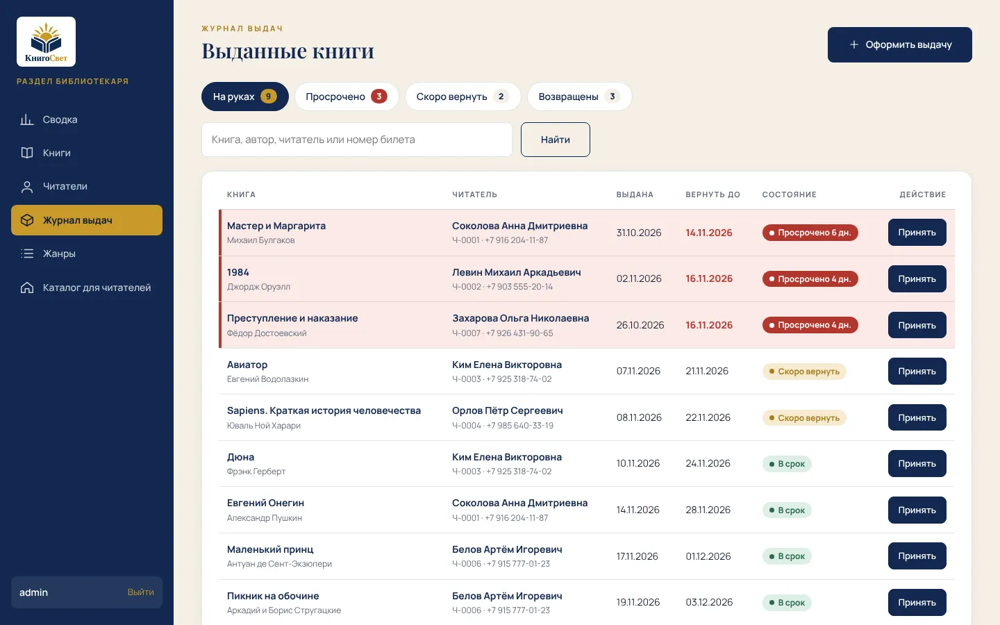
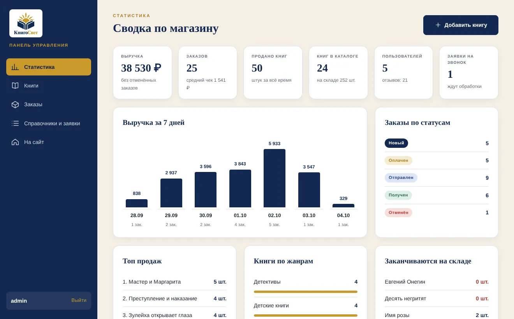
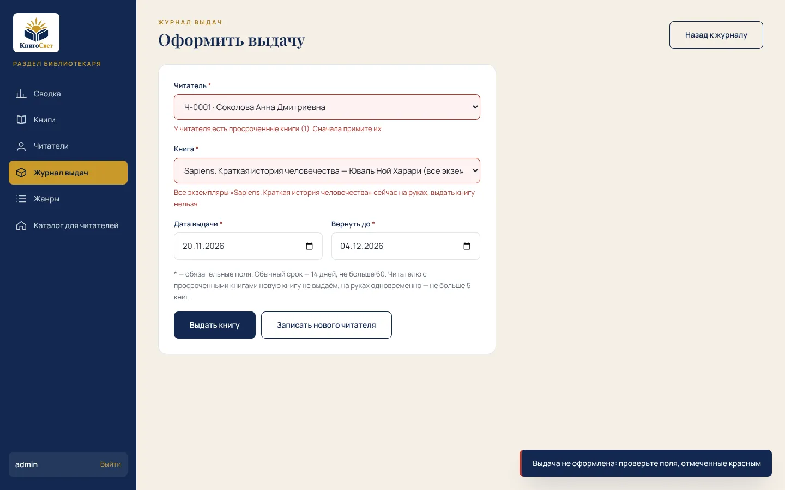
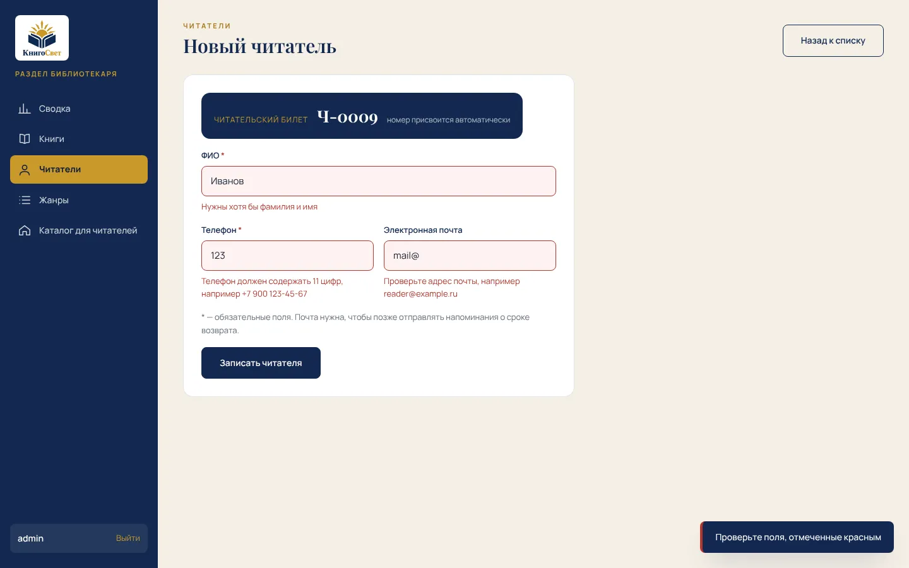

<div align="center">


# КнигоСвет

**Информационная система учёта библиотечного фонда на Django**

Публичный каталог с поиском и отметками «доступна / на руках» и рабочий раздел библиотекаря: книги, читатели, журнал выдач

Учебная практика · специальность 09.02.07 · вариант 1

</div>

---


## Возможности

**Для читателя**
- Поиск по названию и автору, фильтр по жанру и «только доступные сейчас», сортировка
- Карточка книги: сколько экземпляров в фонде, свободно, на руках и когда ожидается ближайший возврат

**Для библиотекаря** (раздел `/panel/`, вход по логину)
- Сводка: свободно, на руках, просрочено, скоро вернуть, список просроченных книг
- Книги: добавление и изменение карточки, поиск, защита от удаления книги с записями в журнале
- Читатели: список с поиском, форма записи с проверкой ФИО, телефона и почты, автоматический номер билета, книги читателя
- Журнал выдач: вкладки «На руках», «Просрочено», «Скоро вернуть», «Возвращены», поиск, просроченные строки выделены красным
- Оформление выдачи: нельзя выдать занятую книгу, выдать книгу читателю с просрочкой, больше 5 книг или срок больше 60 дней
- Возврат кнопкой «Принять» с подтверждением, экземпляр сразу снова доступен в каталоге
- Адаптивная вёрстка: на телефоне журнал выдач показывается карточками

| Журнал выдач | Сводка | Ошибки при выдаче |
|:---:|:---:|:---:|
|  |  |  |

| Каталог | Форма читателя |
|:---:|:---:|
|  |  |

## База данных

| Таблица | Поля | Связи |
|---|---|---|
| `Genre` — жанр | название, ссылка, описание | — |
| `Book` — книга | название, автор, описание, обложка, издательство, год, страниц, ISBN, экземпляров в фонде | жанр |
| `Reader` — читатель | ФИО, номер билета, телефон, почта, дата записи | — |
| `Loan` — выдача | дата выдачи, вернуть до, дата возврата | книга, читатель |

Свободные экземпляры считаются так: `экземпляров в фонде − выдачи без даты возврата`. Выдача просрочена, если даты возврата нет, а срок уже прошёл.

## Технологии

Python, Django, SQLite, HTML, CSS (БЭМ), JavaScript без библиотек, шрифты Playfair Display и Manrope.

## Запуск

```bash
git clone https://github.com/beblozz/knigoSvet.git
cd knigoSvet

python -m venv venv
venv\Scripts\activate          # Windows
source venv/bin/activate       # Linux / macOS

pip install -r requirements.txt

python manage.py migrate
python manage.py loaddata books demo
python manage.py fill_demo

python manage.py runserver
```

- `books` — жанры и 24 книги с обложками
- `demo` — учётная запись библиотекаря
- `fill_demo` — 8 тестовых читателей и записи журнала выдач, даты считаются от сегодняшнего дня, поэтому всегда есть просроченные и «скоро вернуть»

Вход в раздел библиотекаря: `admin` / `admin12345`.

Проверка основных сценариев (выдача, занятая книга, возврат, просрочка, ошибки форм, поиск без совпадений):

```bash
python manage.py test panel
```

| Страница | Адрес |
|---|---|
| Главная | `/` |
| Каталог | `/catalog/` |
| Карточка книги | `/book/<ссылка>/` |
| Раздел библиотекаря | `/panel/` |
| Читатели | `/panel/readers/` |
| Журнал выдач | `/panel/loans/` |
| Оформить выдачу | `/panel/loans/add/` |
| Админка Django | `/admin/` |
