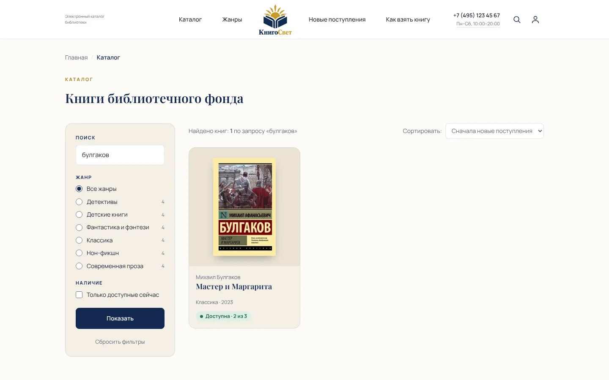
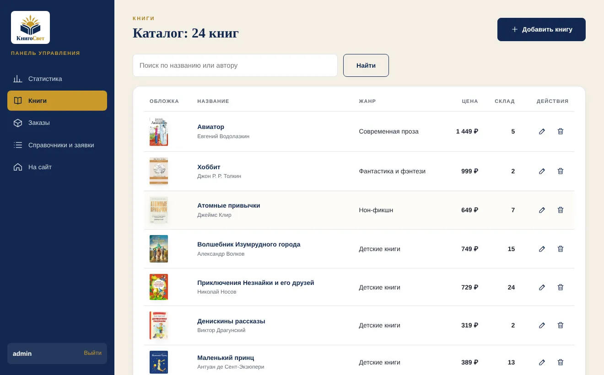

<div align="center">


# КнигоСвет

**Книжный интернет-магазин на Django**

Каталог с фильтрами, корзина, заказы, личный кабинет, отзывы и своя панель управления со статистикой


[Возможности](#-возможности) · [Скриншоты](#-скриншоты) · [Запуск](#-запуск) · [Структура](#-структура-проекта) · [Планы](#-планы)

</div>

---


## ✨ Возможности

**Для покупателя**

- 📚 Каталог из 24 книг с обложками в формате WebP
- 🔎 Поиск по названию и автору, фильтры по жанру, автору, цене и наличию, сортировка, пагинация
- 🛒 Корзина без перезагрузки страницы (fetch + сессии Django)
- 📦 Оформление заказа с выбором доставки и проверкой формы
- 👤 Регистрация, вход, личный кабинет с историей заказов
- ❤️ Избранное и отзывы с оценками
- ☎️ Форма «Заказать звонок» в подвале сайта
- 📱 Адаптивная вёрстка: компьютер, планшет, телефон

**Для администратора**

- 📊 Статистика: выручка, средний чек, количество заказов, график продаж за 7 дней
- 🏆 Топ продаж, книги по жанрам, остатки на складе
- ➕ Добавление, редактирование и удаление книг с загрузкой обложки
- 🔄 Смена статусов заказов
- 🗂 Справочники авторов и жанров, заявки на звонок
- ⚙️ Стандартная админка Django тоже подключена (`/admin/`)

## 🖼 Скриншоты

| Каталог | Страница книги |
|:---:|:---:|
|  |  |

| Статистика | Управление книгами |
|:---:|:---:|
|  |  |

## 🛠 Технологии

| Часть | Что используется |
|---|---|
| Бэкенд | Python, Django |
| База данных | SQLite |
| Фронтенд | HTML, CSS (методология БЭМ), JavaScript без библиотек |
| Изображения | Pillow, формат WebP |
| Шрифты | Playfair Display, Manrope |

## 🚀 Запуск

```bash
git clone https://github.com/beblozz/knigoSvet.git
cd knigoSvet

python -m venv venv
venv\Scripts\activate          # Windows
source venv/bin/activate       # Linux / macOS

pip install -r requirements.txt

python manage.py migrate
python manage.py loaddata books demo

python manage.py runserver
```

Сайт откроется по адресу http://127.0.0.1:8000/

`books` — это жанры, авторы и книги. `demo` — тестовые пользователи, заказы и отзывы, чтобы в статистике сразу были данные. Вторую фикстуру можно не загружать, тогда администратора нужно создать командой `python manage.py createsuperuser`.

### Тестовые аккаунты

| Роль | Логин | Пароль |
|---|---|---|
| Администратор | `admin` | `admin12345` |
| Покупатель | `anna` | `reader12345` |

### Адреса

| Страница | Адрес |
|---|---|
| Главная | `/` |
| Каталог | `/catalog/` |
| Корзина | `/cart/` |
| Личный кабинет | `/users/profile/` |
| Панель управления | `/panel/` |
| Админка Django | `/admin/` |


## 🗃 Модели

| Модель | Приложение | Описание |
|---|---|---|
| `Genre` | catalog | жанр |
| `Author` | catalog | автор |
| `Book` | catalog | книга: цена, остаток, обложка, характеристики |
| `Review` | catalog | отзыв с оценкой от 1 до 5 |
| `Favorite` | catalog | избранное пользователя |
| `CallRequest` | catalog | заявка на звонок |
| `Order` | cart | заказ |
| `OrderItem` | cart | книга в заказе |

